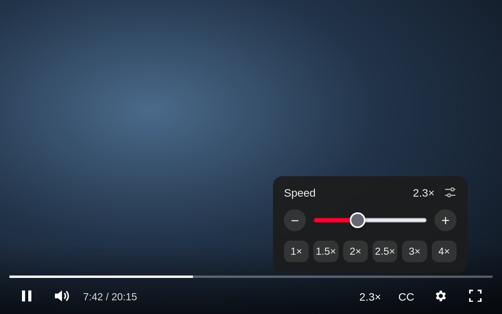
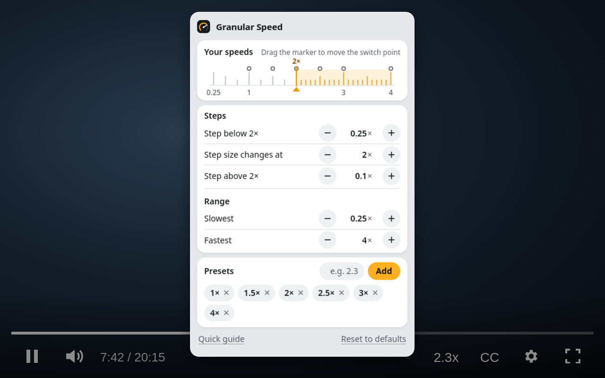

# Granular Speed for YouTube

A Firefox extension for people who find YouTube's 2× limit too slow, and its speed steps too coarse.



YouTube's speed menu stops at 2× and jumps in big steps. 1.75× drags, 2× is fine for one speaker and too fast for the next, and the speed you actually want is often 2.3×. This extension lets you pick it.

## What you get

- **Speeds past 2×.** Out of the box: 0.25× to 4×, in 0.25× steps up to 2× and 0.1× steps above it.
- **Your own steps.** Change both step sizes, where they switch, the slowest and fastest speed (0.1× to 16×), and the preset buttons.
- **Hotkeys.** `Shift` + `.` speeds up, `Shift` + `,` slows down, `R` jumps between 1× and your last speed. They work on any keyboard layout and stay quiet while you type.
- **A button in the player.** It shows the current speed next to the subtitles button. Scroll over it, or click it for a slider and presets.
- **Shorts too.** On Shorts the button becomes a speed pill at the top of the video.
- **It sticks.** YouTube resets the speed on every new video and ad. The extension sets yours back, across videos, tabs and restarts.

## Install

Download the signed `.xpi` from the [latest release](https://github.com/Volzhanka63/granular-speed-for-youtube/releases/latest) and open it in Firefox (File > Open File, or drag it into a window). Firefox asks for confirmation, then keeps it installed. Requires Firefox 142 or newer.

## Settings

Open them from the toolbar button, from `about:addons`, or with the tune icon in the player panel. Changes apply right away in every open YouTube tab.



Firefox mutes audio above 8×. To keep the sound at higher speeds, raise `media.audio.playbackrate.muting_threshold` in `about:config`.

## Privacy

The extension makes no network requests and collects nothing. It stores your current speed and your settings in `browser.storage.local`, inside your Firefox profile. It only runs on `www.youtube.com`.

## How it works

YouTube's 2× cap lives in its menu, not in the video element, so `content.js` sets `video.playbackRate` directly. YouTube resets the rate when a new video or ad loads. Capture-phase listeners for `loadeddata`, `playing` and `ratechange` on `document` catch every `<video>` and put the speed back. There is no polling and no MutationObserver.

| File | Role |
|---|---|
| `manifest.json` | Manifest V3 |
| `shared.js` | Settings defaults, validation and the list of speeds, used by the content script and the settings page |
| `content.js` | Runs on YouTube: hotkeys, player button, Shorts pill, panel |
| `ui.css` | Styles for the button, pill, panel and badge |
| `options.html`, `options.js`, `options.css` | Settings page, also used as the toolbar popup |
| `background.js` | Opens the settings page from the panel. Firefox starts it only on that click |
| `icons/` | PNG icons; `icon.svg` is the source |
| `listing/` | addons.mozilla.org listing text and screenshots, not packaged |

## Development

No build step and no dependencies. You need Node.js for `web-ext`.

```sh
npx web-ext lint
npx web-ext run --start-url https://www.youtube.com/   # fresh Firefox profile with the extension loaded
```

Or load `manifest.json` from `about:debugging#/runtime/this-firefox` in your own Firefox.

To sign a release, get API credentials at https://addons.mozilla.org/developers/addon/api/key/, bump `version` in `manifest.json` (AMO never accepts the same version twice), then:

```sh
# signed .xpi for GitHub releases
WEB_EXT_API_KEY=... WEB_EXT_API_SECRET=... npx web-ext sign --channel=unlisted

# public listing on addons.mozilla.org
WEB_EXT_API_KEY=... WEB_EXT_API_SECRET=... npx web-ext sign --channel=listed --amo-metadata=listing/metadata.json
```

See [CHANGELOG.md](CHANGELOG.md) for what changed in each version. Issues and pull requests are welcome.

## License

[MIT](LICENSE). Not affiliated with YouTube or Google.
