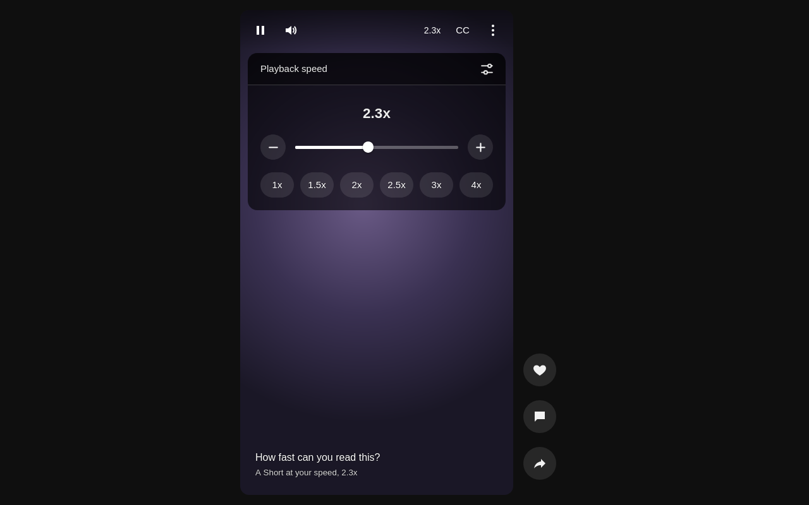

# Granular Speed for YouTube

YouTube past 2x, from the keyboard, in steps you choose. A Firefox extension.


I watch lectures and talks at around 2.3x. Without Premium, YouTube stops at 2x, and its speed keys move a quarter at a time: 1.75x, 2x, done. This extension keeps YouTube's keys and takes the cap off. Above 2x the steps get smaller, 0.1x by default, because that's where a small change decides whether you keep up with the speaker.

## What you get

- **Speeds past 2x.** Out of the box: 0.25x to 4x, in 0.25x steps up to 2x and 0.1x steps above it.
- **YouTube's own keys.** `Shift` + `.` is faster, `Shift` + `,` is slower, `R` jumps between 1x and your speed. They go by key position, so they keep working with another keyboard language switched on. They only act when a video is on the page and stay quiet while you type.
- **A button in the player.** It shows the current speed at the start of the player's right-hand controls and hides with them. Scroll over it, or click it for a slider and presets. On Shorts it sits in the top-right controls, next to CC.
- **Hold for double.** Hold the mouse button down on the video to play at twice your speed, up to your fastest setting. Let go and you're back. YouTube's own hold always gives 2x, which is no help if you already watch at 2x or faster.
- **It sticks.** Your speed carries over to the next video, after ads, in other tabs and after a restart. Hover previews in the feed stay at normal speed.
- **Your own steps.** Change both step sizes, where steps change, the slowest and fastest speed (0.1x to 16x), and up to 8 presets.

## One speed control

YouTube resets the speed on every new video and ad, and the extension sets yours back each time. So YouTube's speed menu can't change it. Pick a speed there and a bubble shows the speed you're really at. This is on purpose. It's the same mechanism that puts your speed back after YouTube resets it.

If you also run another speed extension, turn it off for YouTube. Two extensions that both set the speed will undo each other. When that happens, this one pauses for 3 seconds instead of looping, then sets your speed again.

## Install

Download the signed `.xpi` from the [latest release](https://github.com/Volzhanka63/granular-speed-for-youtube/releases/latest) and open it in Firefox (File > Open File, or drag it into a window). Firefox asks for confirmation, then keeps it installed. Requires Firefox 142 or newer.

## Limits

- Works on `www.youtube.com` in desktop Firefox.
- Not supported: YouTube Music, `m.youtube.com`, Firefox for Android, and YouTube videos embedded on other sites.
- At the live edge of a live stream the extension leaves the speed to YouTube, because there's nothing ahead to speed through. Go back a bit and your speed applies again.
- Firefox mutes audio above 8x. To keep the sound, raise `media.audio.playbackrate.muting_threshold` in `about:config`.

## Settings

The tune icon in the player panel opens the full settings in the top-right corner of the page, like the toolbar popup. It works in fullscreen too. A click outside or `Esc` closes them, and that click doesn't reach the video. The same settings open from the toolbar button and `about:addons`. Changes apply right away in every open YouTube tab, and Reset and preset removal can be undone for a few seconds.




## Privacy

The extension makes no network requests and collects nothing. It stores your current speed and your settings in `browser.storage.local`, inside your Firefox profile. Its only permission is `storage`, and it only runs on `www.youtube.com`.

## How it works

YouTube's 2x cap lives in its menu, not in the video element, so `content.js` sets `video.playbackRate` directly. YouTube resets the rate when a new video or ad loads. Capture-phase listeners for `loadeddata`, `playing`, `seeked` and `ratechange` on `document` catch every `<video>` and put the speed back. There is no polling and no MutationObserver. If something else undoes the speed more than 30 times a second, the extension rests for 3 seconds instead of looping, then sets the speed once more.

| File | Role |
|---|---|
| `manifest.json` | Manifest V3 |
| `shared.js` | Settings defaults, validation and the list of speeds, used by the content script and the settings page |
| `content.js` | Runs on YouTube: keeps the speed applied, hotkeys, hold for double, player button and panel, settings popup |
| `ui.css` | In-player styles, measured from YouTube's own settings menu |
| `options.html`, `options.js`, `options.css` | Settings page, also used as the toolbar popup |
| `welcome.html`, `welcome.js`, `welcome.css` | Welcome page with a live demo of the keys |
| `background.js` | Opens the welcome page once, on install, and on update clears storage keys older versions left behind. Firefox starts it only for install and update events |
| `PRODUCT.md`, `DESIGN.md` | Product facts and the design system, for future design work (not packaged) |
| `icons/` | PNG icons; `icon.svg` is the source |
| `listing/` | addons.mozilla.org listing text and screenshots, not packaged |

## Development

No build step and no dependencies. You need Node.js for `web-ext`.

```sh
npx web-ext lint
npx web-ext run --start-url https://www.youtube.com/   # fresh Firefox profile with the extension loaded
```

Or load `manifest.json` from `about:debugging#/runtime/this-firefox` in your own Firefox.

To sign a release, get API credentials at https://addons.mozilla.org/developers/addon/api/key/, bump `version` in `manifest.json` (AMO never accepts the same version twice), then:

```sh
# signed .xpi for GitHub releases
WEB_EXT_API_KEY=... WEB_EXT_API_SECRET=... npx web-ext sign --channel=unlisted

# public listing on addons.mozilla.org
WEB_EXT_API_KEY=... WEB_EXT_API_SECRET=... npx web-ext sign --channel=listed --amo-metadata=listing/metadata.json
```

See [CHANGELOG.md](CHANGELOG.md) for what changed in each version. Issues and pull requests are welcome.

## License

[MIT](LICENSE). Not affiliated with YouTube or Google.
