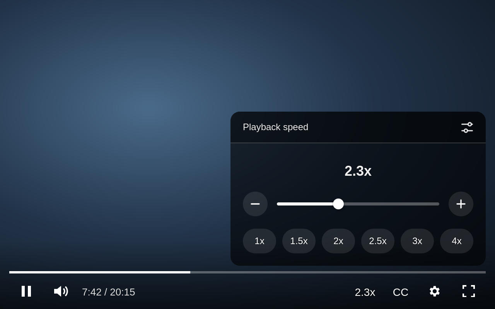
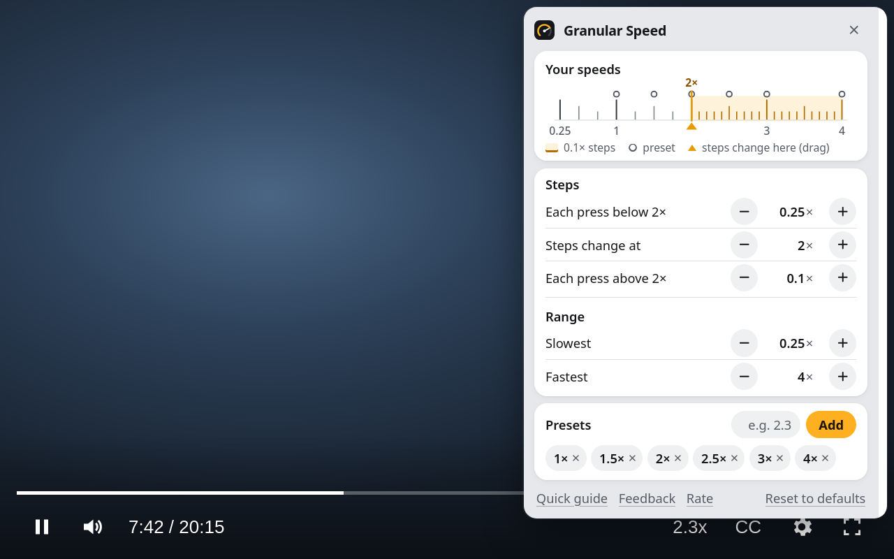

# Granular Speed for YouTube

YouTube's speed control, the way it should have been. Faster than 2x, in steps you choose, with the shortcuts you already know. A Firefox add-on.



I watch lectures and talks at about 2.3x. Without Premium, YouTube stops at 2x, and its steps jump a quarter at a time. The speed add-ons I tried either fought YouTube's defaults and lost, so my speed kept resetting, or came with a hundred features I didn't need. So I made the speed control I wish YouTube had: it goes as fast as you want, in the steps you want, and remembers your speed.

## What it does

**Your speed, your steps.** Everyone has a different comfortable speed. Choose how big each step is, where the steps get finer, and how fast it can go, up to 16x. The shortcuts, the speed button and the presets all follow what you set. The defaults are what I use: 0.25x steps up to 2x, then 0.1x, from 0.25x to 4x.

**Nothing new to learn.** `Shift` + `.` is faster and `Shift` + `,` is slower, the same shortcuts YouTube already has, minus the 2x limit. `R` switches between 1x and your speed. Your speed carries over to the next video, after ads, in other tabs and after a restart, until you change it. YouTube's own speed menu follows it too, so you're never fighting YouTube's defaults.

**Feels like part of YouTube.** The speed button sits in the player's controls and looks like them. Scroll over it to change speed, or click it for a slider and presets. It works on Shorts. Hold the mouse on the video to double your speed: at 2x you get 4x.

That's all it does. It only runs on youtube.com, makes no network requests and adds about 35 KB of code.

## Install

Download the signed `.xpi` from the [latest release](https://github.com/Volzhanka63/granular-speed-for-youtube/releases/latest) and open it in Firefox (File > Open File, or drag it into a window). Firefox asks for confirmation, then keeps it installed. Needs desktop Firefox 142 or newer.

## Using it

### Keyboard shortcuts

| Shortcut | What it does |
|---|---|
| `Shift` + `.` | Faster |
| `Shift` + `,` | Slower |
| `R` | Switch between 1x and your speed |

These are YouTube's own speed shortcuts, without the 2x limit. They go by key position, so they work with any keyboard language. They only act when a video is on the page, and they type as usual while you write a comment or a search.

### Speed button and panel

The speed button shows your speed in the player's controls: bottom right on a regular video, top right on a Short, next to CC. It hides with the rest of the controls. Scroll over it to change speed, or click it for the speed panel: a slider, − and + buttons, and presets.

### Hold to double

Hold the mouse button down on the video for twice your speed, up to your fastest setting. At 1.5x you get 3x. Let go and you're back. This replaces YouTube's own hold, which always gives 2x.

### Settings

Out of the box, speeds go from 0.25x to 4x: 0.25x at a time up to 2x, then 0.1x. In the settings you can change:

- how much each press changes the speed, below and above 2x, as fine as 0.01x
- the speed where the steps change
- the slowest and fastest speed, from 0.1x to 16x
- up to 8 presets

Open them from the settings icon in the speed panel (without leaving the video, fullscreen included), from the toolbar button, or from `about:addons`. Changes apply right away in every open YouTube tab. Reset everything or remove a preset by mistake, and you can undo it for a few seconds.




## Good to know

**YouTube keeps resetting my speed.** That's what this add-on fixes. YouTube resets the speed on every new video and ad, and Granular Speed puts yours back each time.

**I picked a speed in YouTube's menu and it went back.** That's on purpose. There's one speed and it's yours, so the add-on puts it back and shows the speed you're actually at. Change it with the shortcuts or the speed button.

**I use another speed add-on.** Turn it off on YouTube. Two add-ons that both set the speed keep undoing each other. When that happens, Granular Speed waits 3 seconds instead of fighting, then sets your speed again.

**Live streams.** At the live edge there's nothing ahead to speed through, so the add-on leaves the speed to YouTube. Go back a bit and your speed applies again.

**The sound cuts out above 8x.** Firefox mutes audio above 8x. To keep it, raise `media.audio.playbackrate.muting_threshold` in `about:config`.

**Where it works.** `www.youtube.com` in desktop Firefox 142 and newer, including theater mode, fullscreen, the miniplayer and Shorts. Not on YouTube Music, `m.youtube.com`, Firefox for Android, or YouTube videos embedded on other sites. Hover previews in the feed stay at normal speed.

## Feedback

Something broken, or a feature you'd like? Email granular@maxfadeyev.com or [open an issue](https://github.com/Volzhanka63/granular-speed-for-youtube/issues). I keep the add-on small on purpose, so not every idea gets in, but I read all of them. Pull requests are welcome too.

## Privacy

The add-on makes no network requests and collects nothing. It stores your speed and settings in `browser.storage.local`, inside your Firefox profile. Its only permission is `storage`, and it only runs on `www.youtube.com`.

## How it works

YouTube's 2x cap lives in its menu, not in the video element, so `content.js` sets `video.playbackRate` directly. YouTube resets the rate when a new video or ad loads. Capture-phase listeners for `loadeddata`, `playing`, `seeked` and `ratechange` on `document` catch every `<video>` and put the speed back. There is no polling and no MutationObserver. If something else undoes the speed more than 30 times a second, the extension rests for 3 seconds instead of looping, then sets the speed once more.

| File | Role |
|---|---|
| `manifest.json` | Manifest V3 |
| `shared.js` | Settings defaults, validation and the list of speeds, used by the content script and the settings page |
| `content.js` | Runs on YouTube: keeps the speed applied, hotkeys, hold for double, player button and panel, settings popup |
| `ui.css` | In-player styles, measured from YouTube's own settings menu |
| `options.html`, `options.js`, `options.css` | Settings page, also used as the toolbar popup |
| `welcome.html`, `welcome.js`, `welcome.css` | Welcome page with a live demo of the keys |
| `background.js` | Opens the welcome page once, on install, and on update clears storage keys older versions left behind. Firefox starts it only for install and update events |
| `icons/` | PNG icons; `icon.svg` is the source |
| `screenshots/` | Images for this README, not packaged |

## Development

No build step and no dependencies. You need Node.js for `web-ext`.

```sh
npx web-ext lint
npx web-ext run --start-url https://www.youtube.com/   # fresh Firefox profile with the extension loaded
```

Or load `manifest.json` from `about:debugging#/runtime/this-firefox` in your own Firefox.

To sign a release, get API credentials at https://addons.mozilla.org/developers/addon/api/key/, bump `version` in `manifest.json` (AMO never accepts the same version twice), then:

```sh
# signed .xpi for GitHub releases
WEB_EXT_API_KEY=... WEB_EXT_API_SECRET=... npx web-ext sign --channel=unlisted

# public listing on addons.mozilla.org
WEB_EXT_API_KEY=... WEB_EXT_API_SECRET=... npx web-ext sign --channel=listed --amo-metadata=<listing-metadata.json>
```

See [CHANGELOG.md](CHANGELOG.md) for what changed in each version.

## License

[MIT](LICENSE). Not affiliated with YouTube or Google.
